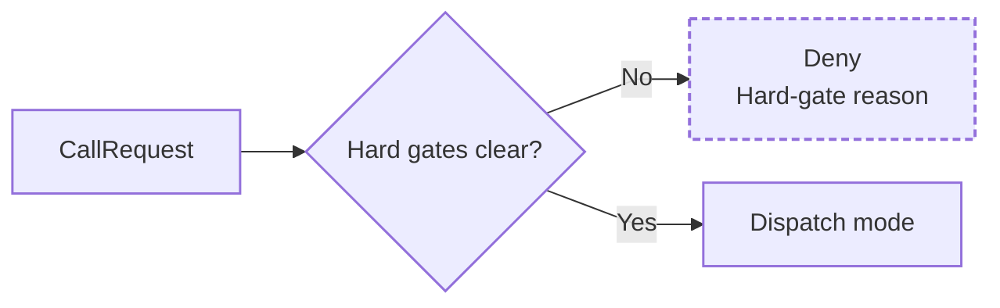
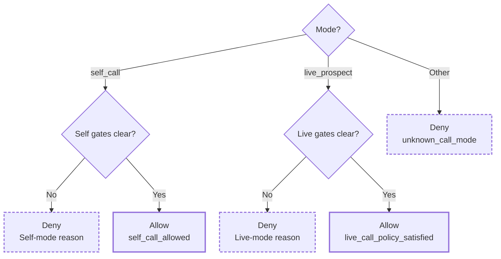

# AI Sales Call Guard

I don't think an AI caller should be able to improvise its way around an off switch.

This Python module sits **before** call transport. Give it a `CallRequest`; it gives you a decision and reason. It does **not** dial anybody. That distinction is doing a lot of work.

### Who gets through?

The universal checks run first: sensitive-data flag, suppressed destination, and daily cap. Failing one of those ends the decision.

Then the mode matters:

| Mode | What has to be true |
| --- | --- |
| `self_call` | Self-tests enabled, destination in the exact self-call allowlist |
| `live_prospect` | Global and live switches on, application-policy input approved, disclosure enabled |
| Anything else | Nope. `unknown_call_mode` |

The supplied self-call list is copied into an immutable set. Changing the caller's original Python set later doesn't silently authorize another number.

This is the sort of feature nobody notices when it works, which is probably what you want from a call-safety gate.

## The call never reaches transport unless both gates agree

The universal checks get first refusal, regardless of mode.

Passing those checks only gets the request as far as its mode-specific policy.

Look at [models](src/sales_call_guard/models.py), [hard and mode gates](src/sales_call_guard/gates.py), [dispatch](src/sales_call_guard/policy.py), and [tests](tests/). The [verification page](docs/verification.md) lists the exact refusal cases.

**No calls are placed here.** No provider credentials, contact data, or campaign workflow. An application setting called `approved` is **not** legal consent, compliance certification, or permission to call someone. See [SECURITY.md](SECURITY.md) and [PROVENANCE.md](PROVENANCE.md).
